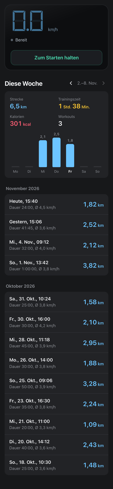
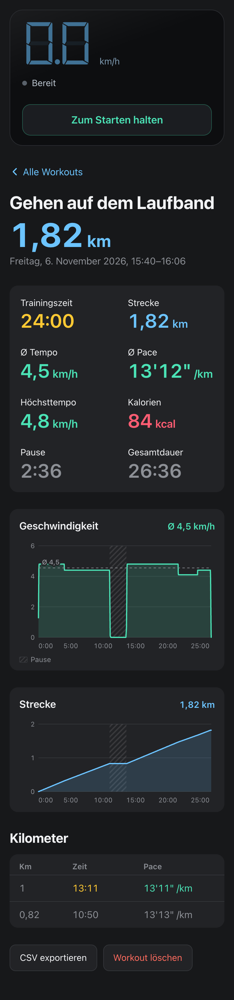
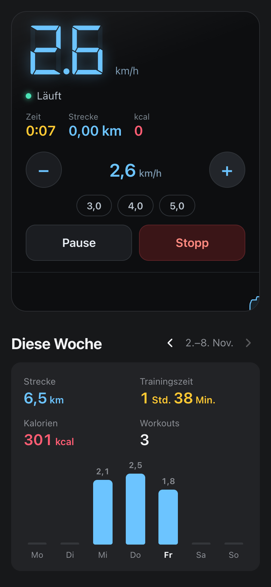
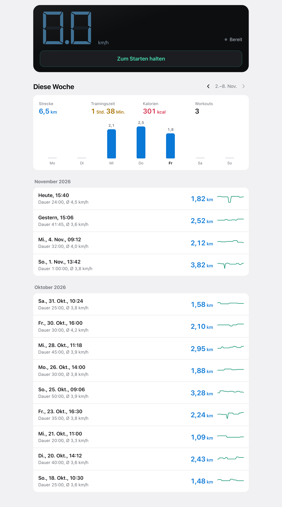

# Laufband-Log

Home-Assistant-App, die Workouts eines PitPat-Walking-Pads aufzeichnet, mit
Verlaufsdiagrammen anzeigt und das Band steuert. Details: [laufband_log/DOCS.md](laufband_log/DOCS.md).

## Screenshots

Mit Demo-Daten (`tests/make_demo.py`) und simuliertem Band (`tests/fake_pad_ha.py`).

  
  
  

## Installation

1. Einstellungen → Apps → App Store → ⋮ → Repositories →
   `https://github.com/TimMixedIt/Laufband-Log` hinzufügen.
2. „Laufband-Log“ installieren und starten. Erscheint als Seitenleisten-Eintrag „Laufband“.

Voraussetzung: HACS-Integration `scphyle/ha-pitpat-treadmill` mit den `walkingpad_*`-Entitäten.
